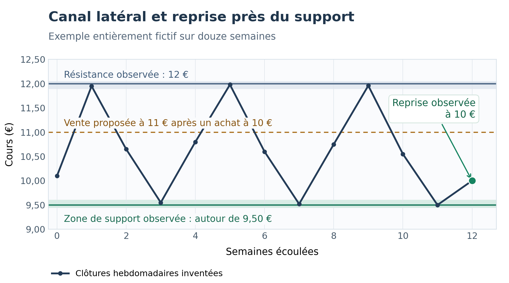

# Choisir un titre-support

## Commencer par une liste de travail

Le titre-support est le titre que l'on souhaite gérer dans un trade. Sa sélection précède le choix du barème et l'évaluation du montant à engager.

On peut partir d'une liste suivie personnellement, d'une plateforme de marché, d'un screener externe ou de `tools profile`. Dans tous les cas, les titres trouvés constituent une liste à examiner. L'utilisateur conserve le choix final.

Pour comprendre un résultat, noter la population étudiée et la date des cours. Une liste Euronext Growth et une liste réunissant plusieurs marchés ne comparent pas les mêmes titres. Un même titre peut changer de rang si la population change.

## Quatre questions pratiques

| Critère principal | Question à poser | Lecture pratique |
|---|---|---|
| Tendance | Le cours monte-t-il, baisse-t-il ou reste-t-il globalement stable ? | Une baisse persistante peut entraîner des achats successifs et immobiliser du capital. |
| Liquidité | Quels montants s'échangent habituellement ? | Mettre cette information en regard des quantités et montants envisagés. |
| Volatilité | Quelle ampleur ont les variations quotidiennes ? | Des mouvements trop faibles limitent les occasions ; des mouvements importants demandent davantage d'attention. |
| Oscillation | Les mouvements changent-ils régulièrement de sens ? | Les allers-retours reposent sur des mouvements dans les deux directions. |

Une variation journalière importante et une oscillation régulière sont différentes. Un titre qui baisse fortement chaque jour peut être volatil tout en offrant peu de retours à la hausse.

Trois critères complètent cette lecture : le **recul maximal**, c'est-à-dire la baisse depuis un sommet antérieur ; les **gaps**, écarts entre une clôture et l'ouverture suivante ; le **pas suggéré**, taille de mouvement proposée pour commencer l'examen d'un barème.

Le chapitre 04 explique les mesures, les seuils et les sept critères de classement. Commencer par les quatre principaux aide à lire le rapport ; les points de vigilance complémentaires restent à examiner.

## Choisir par d'autres voies

L'utilisateur peut retenir un titre sans commencer par `tools profile` ou par le script JEDI. Plusieurs démarches peuvent se compléter :

| Point de départ | Ce qu'il apporte au choix |
|--------------------|------------------------------------------------------------|
| Liste personnelle | Quelques entreprises déjà suivies, dont on connaît les principales activités et les événements récents. |
| Analyse de l'entreprise | Examen de son activité, de ses résultats, de son endettement et de ses perspectives. |
| Marché ou secteur | Mise en contexte du titre par rapport aux autres valeurs et à la direction du marché. |
| Lecture du graphe | Observation de la tendance, des oscillations et de la position du cours dans un canal. |

Ces démarches aboutissent à des titres à examiner. Pour chaque projet, vérifier aussi la liquidité, les variations, le barème et le financement. Une entreprise appréciée peut présenter un cours peu adapté aux allers-retours envisagés.

## Consulter plusieurs sites boursiers

ProRealTime est un exemple parmi plusieurs sites utilisables pour préparer cette sélection. La démarche de lecture du graphe est indépendante du site choisi :

| Site | Utilisation possible |
|--------------------|------------------------------------------------------------|
| [ProRealTime](https://www.prorealtime.com/fr/) | Graphiques, indicateurs et tracés de tendance ; ProRealTrend pour les repères automatiques. |
| [TradingView](https://fr.tradingview.com/) | Graphiques, indicateurs et outils de dessin pour les tendances et les canaux. |
| [Boursorama](https://www.boursorama.com/bourse/) | Fiches valeurs, graphiques, volumes et actualités boursières. |
| [Zonebourse](https://www.zonebourse.com/) | Graphiques, informations sur les entreprises et sélection selon des critères fondamentaux ou techniques. |

Cette liste donne des exemples, sans imposer un fournisseur. Les outils du courtier peuvent également convenir. Pour comparer deux affichages, examiner le même titre, la même place de cotation et la même période ; vérifier la date des données et leurs ajustements. Les possibilités graphiques, l'historique disponible et les conditions d'accès se vérifient sur chaque site.

## Lire le graphe et ses repères

Sur la plateforme graphique choisie, afficher d'abord une vue hebdomadaire pour lire la direction générale, puis une vue journalière pour examiner les mouvements récents. Une barre hebdomadaire représente une semaine ; une barre journalière, une séance. Garder la même unité de temps pour appliquer le critère d'entrée choisi.

Un **support** est une zone où le cours a déjà trouvé des acheteurs et rebondi. Une **résistance** est une zone où sa progression a été freinée. Un **canal** délimite l'espace entre une borne basse et une borne haute ; il peut être horizontal ou incliné. Ces repères restent des observations du passé, et peuvent être franchis.

ProRealTime permet de dessiner les lignes de tendance. Son module ProRealTrend peut aussi afficher des supports, résistances et canaux détectés automatiquement. Ces tracés aident à examiner le graphe ; ils ne valident pas le choix du titre pour Jedi. Les repères sont expliqués dans le [manuel officiel ProRealTrend](https://www.prorealtime.com/en/help-manual/prorealtrend-support-resistance-lines), en anglais.

### Rechercher des oscillations dans un canal

Un canal latéral ou haussier avec plusieurs mouvements de hausse et de baisse constitue une situation à examiner pour Jedi : les mouvements dans les deux sens peuvent permettre les ventes sur hausse et les rachats sur baisse du barème. Une hausse presque continue peut offrir peu de rachats. Un canal étroit peut offrir des mouvements insuffisants pour atteindre les niveaux utiles ou couvrir les frais.

Choisir une période d'observation en semaines et noter sa durée. **Il n'existe pas ici de nombre de semaines qui garantisse la poursuite du canal.** Examiner surtout si plusieurs oscillations sont visibles, si les bornes peuvent être tracées sans les déplacer pour arranger le dessin, et si les mouvements correspondent aux niveaux du barème envisagé.

La vue hebdomadaire permet aussi de replacer le canal récent dans un historique plus long. Un petit canal haussier peut se former au sein d'une baisse plus ancienne. Examiner ce contexte avant de retenir le titre.

### Exemple fictif de canal latéral

*Canal fictif : support proche de 9,50 €, résistance proche de 12 €, reprise à 10 €.*

Ce dessin est entièrement inventé. Il ne reprend ni les cotations EXA fournies ni celles d'un titre réel. Les douze semaines sont une durée pédagogique choisie pour montrer plusieurs oscillations ; elles ne constituent pas un seuil de sélection.

Le cours a plusieurs fois parcouru une partie du canal, entre une zone basse proche de 9,50 € et une zone haute proche de 12 €. Après un nouveau retour près du support, une reprise à 10 € apparaît. Si un achat initial était effectivement exécuté à 10 € avec le barème à mouvements de 10 % du chapitre 07, la première vente serait proposée à 11 €, sous la résistance observée. Cela laisse de la place pour ce premier mouvement ; les ventes suivantes et une éventuelle sortie du canal restent à examiner.

La forme du canal donne un contexte à la sélection. Elle ne démontre ni que le cours atteindra 11 €, ni que le trade sera profitable. Le [chapitre 07](07_ouvrir_un_trade.md#préparer-lentrée-sur-un-rebond-près-du-support) explique comment passer de cette observation au projet d'achat initial.

## Compléter la lecture avec quelques indicateurs

| Indicateur | Utilité pour cet examen | Limite à garder en tête |
|----------------|--------------------------------|--------------------------------|
| Moyenne mobile | Lisser les cours pour mieux lire leur direction générale. | Elle utilise les cours déjà observés et réagit avec retard. |
| ATR | Mesurer l'amplitude récente des variations, gaps compris. | Il ne donne pas leur direction et ne mesure pas la largeur du canal. |
| RSI | Examiner la vigueur des mouvements récents. | Une valeur élevée ou faible peut persister dans une tendance forte. |

Chaque indicateur doit répondre à une question compréhensible. La moyenne mobile et le RSI aident à décrire le mouvement. L'ATR aide à apprécier son amplitude ; le comparer aux mouvements observés et aux niveaux du barème. Vérifier aussi les volumes échangés et les événements de l'entreprise. Plusieurs indicateurs tirés des mêmes cours n'apportent pas autant de confirmations indépendantes.

Le [guide des indicateurs Fidelity](https://www.fidelity.com/learning-center/trading-investing/technical-analysis/technical-indicator-guide) présente les définitions de la [moyenne mobile](https://www.fidelity.com/learning-center/trading-investing/technical-analysis/technical-indicator-guide/sma), de l'[ATR](https://www.fidelity.com/learning-center/trading-investing/technical-analysis/technical-indicator-guide/atr) et du [RSI](https://www.fidelity.com/learning-center/trading-investing/technical-analysis/technical-indicator-guide/rsi), en anglais.

## Distinguer le titre retenu et le moment de l'entrée

Une fois le titre retenu, la position du cours dans le canal devient importante. Dans le scénario décrit ici, l'entrée recherchée est **le premier rebond observable à la hausse après un retour dans la zone de support**. Définir à l'avance comment reconnaître cette reprise, puis vérifier la place restante jusqu'à la résistance et le financement d'une poursuite de la baisse.

Conserver la date, l'unité de temps, les repères du canal et le critère d'entrée choisi, par exemple avec une capture du graphe. Une analyse faite après les mouvements ne doit pas être présentée comme une décision possible avant leur réalisation. Pour comparer plusieurs méthodes de sélection, la partie III explique les études historiques et leurs limites.

L'analyse graphique comporte une part d'interprétation. L'étude de [Lo, Mamaysky et Wang (2000)](https://www.cis.upenn.edu/~mkearns/teaching/cis700/lo.pdf) trouve une information supplémentaire dans certaines formes graphiques ; elle ne valide pas ce critère d'entrée ni sa rentabilité avec Jedi.

L'achat initial reste une décision de l'utilisateur. Une fois l'exécution enregistrée, les ordres de fonctionnement sont calculés par Jedi à partir du barème, des opérations et des règles de capital. Les niveaux dessinés sur une plateforme ne modifient pas automatiquement ces calculs.

## Utiliser une sélection externe

Un screener filtre une population selon des conditions. Le ProScreener JEDI de l'annexe 03 utilise des barres journalières et recherche une tendance compatible, une liquidité minimale et une volatilité suffisante. Il affiche aussi l'oscillation.

Choisir explicitement le marché ou la liste de titres dans la plateforme, puis lire les résultats sur une séance terminée. Repérer quelques titres et vérifier leur historique, leurs volumes et les éventuels événements récents.

La sélection externe et `profile` doivent fournir des listes cohérentes sur les principaux critères. Des différences peuvent venir de la date, du fournisseur, des ajustements des cours, du calcul de tendance ou de l'historique disponible. La concordance parfaite des listes n'est pas un objectif de choix.

Le script JEDI et sa procédure sont repris dans [l'annexe 03](fr_annex03_scripts_de_selection_externe.md).

## Utiliser une base de marché Jedi

Pour essayer les commandes avant de préparer vos propres données, suivre [le début du chapitre 10 : la base Demo des exemples](10_base_de_cotations.md#la-base-demo-des-exemples). Ce parcours crée la source `demo` et le dataset `Demo`, puis les met à jour. Le chapitre 04 les utilise pour expliquer les résultats de `profile`.

Une base de marché classe les historiques par **dataset**, ensemble importé, et peut réunir des titres dans des **groupes**, listes logiques définies par l'utilisateur.

~~~console
jedidemo tools profile --database=abcbourse --dataset=Euronext_A --rank-criteria=4
~~~

Cette commande examine les titres du dataset `Euronext_A` et additionne leurs rangs sur les quatre premiers critères. Remplacer `abcbourse` et le dataset par ceux de la base effectivement préparée.

Un groupe peut réunir des titres de plusieurs datasets :

~~~console
jedidemo tools profile --database=abcbourse --group=PEA --rank-criteria=4
~~~

Combiner `--dataset` et `--group` retient leur intersection. Le groupe `PEA` est une liste enregistrée dans la base ; son nom ne vérifie pas automatiquement l'éligibilité de chaque titre.

Les exemples préparatoires de Jedi utilisent notamment des historiques français et les datasets `Euronext_A`, `Euronext_B`, `Euronext_C`, `Euronext_Access` et `Euronext_Growth`. Ces noms n'imposent pas le marché sur lequel utiliser le logiciel.

## Travailler avec un fichier individuel

Une base de marché n'est pas nécessaire pour étudier un titre déjà choisi. Un **fichier préparé** contient ses cotations dans un format lisible par Jedi, avec son identité et des lignes OHLCV contrôlées. Sa préparation est expliquée aux chapitres 05 et 10.

Le fichier fictif [cotations_EXA.txt](../../examples/cotations_EXA.txt) se trouve dans le répertoire **examples/** livré avec cette documentation. Les données sont fournies sous forme de fichiers utilisables, séparément du texte des chapitres. Le [guide des exemples](../../examples/README.md) explique comment préparer le terminal et isoler les essais.

Après la copie des fichiers dans `~/jedi-examples/` au chapitre 02, les commandes suivantes utilisent directement le fichier. `jedidemo` ouvre ce dossier ; aucun import dans une base de marché n'est nécessaire :

~~~console
jedidemo tools profile cotations_EXA.txt
jedidemo tools score cotations_EXA.txt --sort=fitness --budget=40
~~~

Le premier rapport décrit le titre ; le second recherche des barèmes. Le budget de 40 permet une démonstration courte. Le budget courant du programme est de 500.

`profile` calcule les critères récents sur 252 séances, avec un contrôle de qualité sur l'historique long. `score` conserve 750 séances par défaut pour simuler davantage de situations. Le chapitre 05 explique cette différence et comment examiner une autre période.

## Passer au projet de trade

Après choix d'un barème, évaluer le candidat avec son ISIN, une définition de barème et un prix actuel vérifié :

~~~console
jedidemo tools candidate FR4487601001 --price=10 \
  --scale="vr:10%,np:3,nn:3,ki:10%,kb:1,kd:0" \
  --amount=1000 --capital=5000
~~~

Cet exemple utilise un titre et un prix **fictifs**. Il évalue un achat initial de 100 titres et les besoins du projet. Il ne lit pas les cotations du fichier `EXA` : le prix de 10 € est fourni explicitement pour illustrer le calcul.

Avant de retenir le titre, lire ses alertes, examiner le barème, vérifier les ordres utiles et le financement. S'il reste une difficulté, choisir un autre projet ou préciser les données plutôt que retenir automatiquement la première ligne d'un classement.
