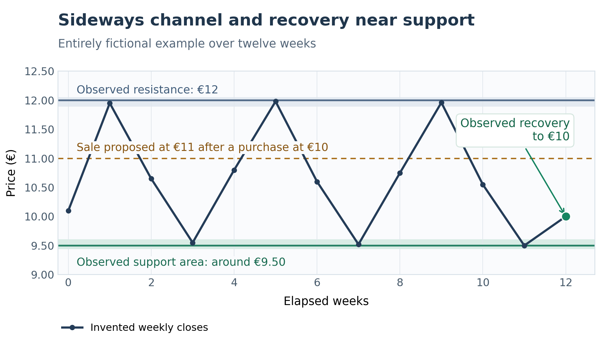

# Choosing a security

## Start with a working list

The security is the instrument to manage within a trade. Selecting it comes before choosing a scale and evaluating the amount to commit.

You can start with a personal watchlist, a market platform, an external screener or `tools profile`. In every case, the securities found form a list to examine. The user keeps the final choice.

To understand a result, record the population studied and the quotation date. An Euronext Growth list and a list spanning several markets compare different securities. The same security can change rank when the population changes.

## Four practical questions

| Main criterion | Question | Practical reading |
|---|---|---|
| Trend | Is the price broadly rising, falling or stable? | A persistent decline can lead to successive purchases and tie up capital. |
| Liquidity | What amounts are normally traded? | Compare this information with the proposed quantities and amounts. |
| Volatility | How large are daily price movements? | Small movements limit opportunities; large movements call for more attention. |
| Oscillation | Do movements regularly change direction? | Round trips depend on movements in both directions. |

A large daily movement and regular oscillation are different. A security falling sharply every day can be volatile while providing few upward reversals.

Three criteria complete this reading: **maximum drawdown**, the decline from a previous peak; **gaps**, differences between a close and the following open; and the **suggested step**, a movement size proposed as a starting point for examining a scale.

Chapter 04 explains the measures, thresholds and seven ranking criteria. Starting with the four main criteria helps read the report; additional cautions still need examination.

## Choose through other routes

The user can select a security without starting with `tools profile` or the JEDI script. Several approaches can complement each other:

| Starting point | Contribution to the choice |
|--------------------|------------------------------------------------------------|
| Personal watchlist | A few businesses already followed, with familiar activities and recent events. |
| Company analysis | Examination of its business, results, debt and prospects. |
| Market or sector | Context from other securities and the market's direction. |
| Chart reading | Observation of the trend, oscillations and price position within a channel. |

These approaches produce securities to examine. For each proposal, also check liquidity, movements, the scale and funding. A business you appreciate may have a price path poorly suited to the contemplated round trips.

## Consult several market websites

ProRealTime is one example among several websites usable for this selection. The approach to chart reading is independent of the chosen website:

| Website | Possible use |
|--------------------|------------------------------------------------------------|
| [ProRealTime](https://www.prorealtime.com/en/) | Charts, indicators and trend drawings; ProRealTrend for automatic reference areas. |
| [TradingView](https://www.tradingview.com/) | Charts, indicators and drawing tools for trends and channels. |
| [Boursorama](https://www.boursorama.com/bourse/) | Security pages, charts, volumes and market news. |
| [Zonebourse](https://www.zonebourse.com/) | Charts, company information and selection using fundamental or technical criteria. |

These are examples, with no required provider. The broker's tools may also be suitable. When comparing two displays, examine the same security, trading venue and period; check data dates and adjustments. Check chart features, available history and access conditions on each website.

## Read the chart: trend, support and resistance

On your chosen chart platform, first display a weekly view to read the broad direction, then a daily view to examine recent movements. A weekly bar represents a week; a daily bar represents a trading session. Keep the same time frame when applying your chosen entry criterion.

**Support** is an area where the price has previously found buyers and rebounded. **Resistance** is an area where its advance has been held back. A **channel** marks the space between a lower and an upper boundary; it may be horizontal or sloping. These reference areas describe past behaviour and can be breached.

ProRealTime allows trend lines to be drawn. Its ProRealTrend module can also display automatically detected support, resistance and channels. These drawings help examine a chart; they do not validate a security for Jedi. See the [official ProRealTrend manual](https://www.prorealtime.com/en/help-manual/prorealtrend-support-resistance-lines).

### Look for oscillations within a channel

A sideways or rising channel with several upward and downward movements is a situation worth examining for Jedi: movements in both directions may allow the scale's sales on rises and purchases on falls. A nearly uninterrupted rise may provide few repurchases. A narrow channel may provide movements insufficient to reach useful levels or cover fees.

Choose an observation period in weeks and record its length. **No number of weeks used here guarantees that the channel will continue.** Examine whether several oscillations are visible, whether boundaries can be drawn without moving them to improve the picture, and whether movements correspond to the proposed scale's levels.

The weekly view also places the recent channel within a longer history. A small rising channel can develop within an older decline. Examine that context before retaining the security.

### Fictional example: a sideways channel

*Fictional channel: support near €9.50, resistance near €12, recovery to €10.*

This drawing is entirely invented. It uses neither the supplied EXA quotations nor a real security's prices. Twelve weeks is a teaching choice showing several oscillations, not a selection threshold.

The price has repeatedly travelled through part of the channel, between a lower area near €9.50 and an upper area near €12. After another return close to support, a recovery to €10 appears. If an initial purchase were actually executed at €10 with chapter 07's scale using 10% movements, the first sale would be proposed at €11, below the observed resistance. That leaves room for this first movement; subsequent sales and a possible departure from the channel still need examination.

The channel's shape provides selection context. It proves neither that the price will reach €11 nor that the trade will be profitable. [Chapter 07](en_07_opening_a_trade.md#prepare-an-entry-on-a-rebound-near-support) explains how to move from this observation to an initial purchase proposal.

## Supplement the reading with a few indicators

| Indicator | Use in this examination | Limitation to remember |
|----------------|--------------------------------|--------------------------------|
| Moving average | Smooth prices to make their broad direction easier to read. | It uses prices already observed and responds with a lag. |
| ATR | Measure the recent size of movements, including gaps. | It gives no direction and does not measure channel width. |
| RSI | Examine the strength of recent price movements. | A high or low reading can persist during a strong trend. |

Each indicator should answer an understandable question. The moving average and RSI help describe the movement. ATR helps assess its size; compare it with observed movements and scale levels. Also check traded volumes and company events. Several indicators derived from the same prices do not provide as many independent confirmations.

The [Fidelity indicator guide](https://www.fidelity.com/learning-center/trading-investing/technical-analysis/technical-indicator-guide) presents definitions of the [moving average](https://www.fidelity.com/learning-center/trading-investing/technical-analysis/technical-indicator-guide/sma), [ATR](https://www.fidelity.com/learning-center/trading-investing/technical-analysis/technical-indicator-guide/atr) and [RSI](https://www.fidelity.com/learning-center/trading-investing/technical-analysis/technical-indicator-guide/rsi).

## Distinguish security selection from entry timing

Once the security is retained, its price position within the channel matters. In this scenario, the sought entry is **the first observable upward rebound after a return to the support area**. Define beforehand how to recognise that recovery, then check remaining room towards resistance and funding for a continued decline.

Keep the date, time frame, channel reference areas and chosen entry criterion, for example with a chart screenshot. An analysis performed after the movements must not be presented as a decision possible before they occurred. Part III explains historical studies and their limits when comparing selection methods.

Chart analysis involves interpretation. The study by [Lo, Mamaysky and Wang (2000)](https://www.cis.upenn.edu/~mkearns/teaching/cis700/lo.pdf) finds additional information in some chart patterns; it validates neither this entry criterion nor its profitability with Jedi.

The initial purchase remains the user's decision. Once execution is recorded, Jedi calculates operating orders from the scale, operations and capital rules. Levels drawn on a platform do not automatically change these calculations.

## Use an external selection

A screener filters a population according to conditions. The JEDI ProScreener in Appendix 03 uses daily bars and looks for a compatible trend, minimum liquidity and sufficient volatility. It also displays oscillation.

Explicitly choose the market or security list in the platform, then read the results for a completed session. Pick a few securities and examine their history, volumes and recent events.

External selection and `profile` should provide coherent lists on the main criteria. Differences can arise from the date, provider, price adjustments, trend calculation or available history. Perfect agreement between lists is not a selection objective.

The JEDI script and procedure are included in [Appendix 03](en_annex03_external_selection_scripts.md).

## Use a Jedi market database

To try commands before preparing your own data, follow [the start of chapter 10: the Demo database for the examples](en_10_market_database.md#the-demo-database-for-the-examples). It creates source `demo` and dataset `Demo`, then updates them. Chapter 04 uses them to explain `profile` results.

A market database organises histories into **datasets**, imported collections, and can bring securities together in **groups**, logical lists defined by the user.

~~~console
jedidemo tools profile --database=abcbourse --dataset=Euronext_A --rank-criteria=4
~~~

This command examines the securities in `Euronext_A` and sums their ranks on the first four criteria. Replace `abcbourse` and the dataset with those of the database actually prepared.

A group can combine securities from several datasets:

~~~console
jedidemo tools profile --database=abcbourse --group=PEA --rank-criteria=4
~~~

Combining `--dataset` and `--group` selects their intersection. `PEA` is a list stored in the database; its name does not automatically verify each security's eligibility.

Jedi's preparatory examples include French histories and the datasets `Euronext_A`, `Euronext_B`, `Euronext_C`, `Euronext_Access` and `Euronext_Growth`. These names do not prescribe which market the application must be used on.

## Work with an individual file

A market database is unnecessary when studying a security already chosen. A **prepared file** contains its quotations in a format Jedi can read, with its identity and checked OHLCV rows. Chapters 05 and 10 explain preparation.

The fictional [cotations_EXA.txt](../../examples/cotations_EXA.txt) file is in the **examples/** directory supplied with this documentation. Data are provided as usable companion files, separately from the chapter text. The [example guide](../../examples/README.md) explains terminal preparation and how to keep experiments separate.

After copying the files to `~/jedi-examples/` in chapter 02, the following commands use the file directly. `jedidemo` opens that directory; no market database import is needed:

~~~console
jedidemo tools profile cotations_EXA.txt
jedidemo tools score cotations_EXA.txt --sort=fitness --budget=40
~~~

The first report describes the security; the second searches for scales. A budget of 40 provides a short demonstration. The application's standard budget is 500.

`profile` calculates recent criteria on 252 sessions, with a quality check over the long history. `score` retains 750 sessions by default to simulate more situations. Chapter 05 explains the difference and how to examine another period.

## Move on to the trade proposal

After choosing a scale, evaluate the candidate with its ISIN, a scale definition and a checked current price:

~~~console
jedidemo tools candidate FR4487601001 --price=10 \
  --scale="vr:10%,np:3,nn:3,ki:10%,kb:1,kd:0" \
  --amount=1000 --capital=5000
~~~

This example uses a **fictional** security and price. It evaluates an initial purchase of 100 shares and the proposal's requirements. It does not read prices from the `EXA` file: the €10 price is supplied explicitly to illustrate the calculation.

Before retaining a security, read its cautions, examine the scale, check useful orders and funding. If a difficulty remains, choose another proposal or clarify the data rather than automatically retaining the first ranking row.
